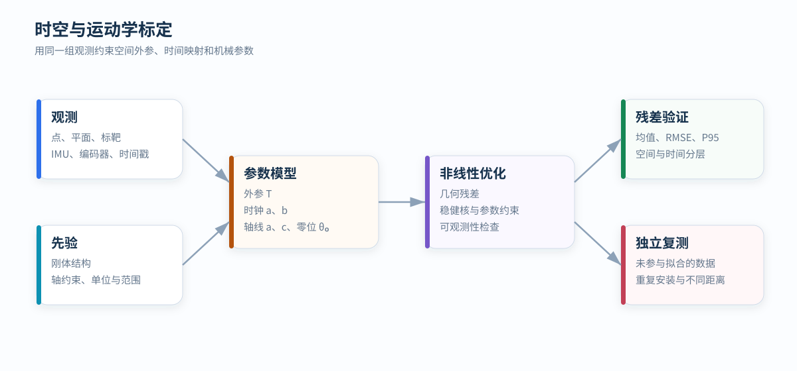

# 时空与运动学标定

标定把多源观测放进同一坐标系和时间轴，并估计机械结构中的轴线、零位与尺度。参数必须由足够丰富的运动和几何约束才能被唯一辨识。

  参数：外参 · 时钟 · 旋转轴 · 零位
  方法：几何残差 + 非线性最小二乘

<figure markdown="span">
  
  <figcaption>观测与结构先验共同约束参数，拟合残差和独立复测分别评价内部一致性与泛化能力。</figcaption>
</figure>

## 空间外参

两个刚性连接传感器之间的空间关系由旋转和平移组成：

pᴮ = Rᴮ←ᴬ pᴬ + tᴮ←ᴬ

外参的六个自由度只有在观测包含足够方向和深度变化时才能稳定求解。单一平面只能强约束法向方向与到平面的距离，对平面内平移和绕法向旋转约束较弱。

常见几何观测包括：

- 标定板或墙面的点到平面距离；
- 球靶、角点或控制标靶的点到点距离；
- 多姿态下同一静态结构的重合残差；
- 雷达与相机之间的边缘、平面或目标中心对应。

## 时间映射

不同设备的时钟可用仿射关系描述：

t_host = a · t_device + b

`b` 是时钟偏移，`a` 是频率比例。只估计固定偏移默认两个时钟速率完全相同；采集时间较长或晶振频差明显时，需要同时估计 `a`。

如果每次观测获得主机发送时刻 `t₁`、设备时间 `t_d` 与主机接收时刻 `t₂`，设备事件对应的主机时刻通常位于区间 `[t₁,t₂]`。往返时延近似对称时可用中点 `(t₁+t₂)/2` 建立拟合样本，并用稳健损失降低调度抖动和异常延迟的影响。

时间偏差与旋转外参可能互相混淆：匀速旋转时，固定时间偏移近似等效为固定角度偏移。加入变速段或独立时间事件有助于分离二者。

## 旋转轴模型

空间旋转轴由单位方向 `a` 和轴上一点 `c` 表示。角度为 `θ` 时：

p′ = c + R(a, θ)(p-c)

需要注意以下规范自由度：

- `a` 与 `-a` 可通过角度符号互换；
- `c` 沿轴方向移动不会改变轴线；
- 零角与固定外参绕轴旋转存在耦合；
- 编码器比例与角度范围不足时可能相关。

可选取距离原点最近的轴上点，并固定角度方向约定，消除表示上的多解。

## 联合目标函数

把几何、时间和机械参数组成向量 `ξ`，一般目标函数为：

minξ Σk ρ( rₖ(ξ)ᵀ Wₖ rₖ(ξ) ) + ‖ξ - ξ₀‖²_Λ

`rₖ` 是点到平面、点到点、姿态闭合或时间对应残差；`Wₖ` 反映观测不确定性；`Λ` 表示合理先验。参数单位不同，优化前应进行尺度归一化。

## 可观测性设计

| 参数 | 需要的激励或几何 |
| --- | --- |
| 三维旋转外参 | 多方向平面或多轴旋转 |
| 平移外参 | 不同深度目标与角运动产生的杠杆臂效应 |
| 时间偏移 | 足够明显的运动，最好包含速度变化 |
| 时钟比例 | 较长时间跨度和稳定的对应事件 |
| 旋转轴方向 | 多角度观测且场景不关于轴高度对称 |
| 轴心与偏心 | 不同距离和方位的稳定结构 |
| 编码器比例 | 足够大的角度范围与闭合约束 |

提高样本数量不能自动消除退化。若所有样本都来自同一姿态或同一平面，信息矩阵仍可能秩亏。

## 残差与验证

拟合残差反映数据对模型的内部一致性，但不能单独证明参数正确。验证至少包含：

1. 使用未参与优化的独立数据；
2. 按距离、方向、姿态和时间分层统计；
3. 同时报告均值、MAE、RMSE、P95 与最大值；
4. 检查残差是否随角度或时间呈周期性结构；
5. 重复安装或重复采集，评价参数重复性；
6. 将参数用于下游点云重合，检查平面厚度和闭合误差。

残差小但参数在多次试验间大幅变化，通常说明问题可观测性不足或参数之间存在强相关。
