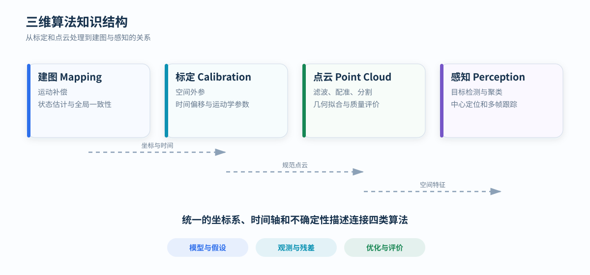

---
hide:
  - toc
---

  <h1>三维感知与建图算法笔记</h1>
  
围绕激光雷达、编码器与惯性传感器，整理建图、标定、点云处理和目标感知中的数学模型、数据流、评价指标与退化条件。

<figure markdown="span">
  
  <figcaption>坐标、时间和不确定性是建图、标定、点云处理与感知之间的公共语言。</figcaption>
</figure>

## 主题

  

    MAPPING
    <h3>建图</h3>
    
研究运动补偿、状态估计、点云配准和全局一致性。内容覆盖固定轴运动、LiDAR–IMU 里程计与站点位姿图。

    <a href="mapping/">进入建图方法</a>
  

  

    CALIBRATION
    <h3>标定</h3>
    
研究空间外参、时间映射、旋转轴、零位与尺度参数的可观测性、求解方法和残差验证。

    <a href="calibration/">进入标定</a>
  

  

    POINT CLOUD
    <h3>点云处理</h3>
    
研究过滤、采样、法向估计、配准、分割、表面拟合和几何质量评价。

    <a href="point-cloud/">进入点云处理</a>
  

  

    PERCEPTION
    <h3>感知</h3>
    
研究候选生成、三维聚类、中心估计、数据关联和多帧状态滤波。

    <a href="perception/">进入感知</a>
  

## 建图方法

  

    KNOWN MOTION
    <h3>编码器逐点补偿</h3>
    
编码器给出固定轴角度，逐点时间决定每个激光点的机械姿态。适用于运动自由度已知且机械模型可信的旋转扫描。

    <a href="mapping/dual-encoder/">阅读算法</a>
  

  

    LIDAR–IMU
    <h3>FAST-LIO2</h3>
    
IMU 传播连续状态，激光点对局部地图平面的残差迭代修正姿态、位置、速度与零偏。

    <a href="mapping/kalman-fast-lio/">阅读算法</a>
  

  

    BATCH OPTIMIZATION
    <h3>编码器约束站点优化</h3>
    
离散停站子图形成相对位姿边，共享转轴模型与鲁棒 SE(3) 位姿图联合约束整圈地图。

    <a href="mapping/encoder-global-opt/">阅读算法</a>
  

## 统一分析框架

算法说明按同一组问题展开：

1. **状态与参数**：求解对象是什么，哪些量固定，哪些量需要估计；
2. **观测与残差**：传感器提供什么信息，误差如何进入目标函数；
3. **可观测性**：什么场景和运动能约束参数，什么条件会退化；
4. **计算结构**：逐点计算、递推滤波或批量优化；
5. **质量评价**：残差、覆盖、厚度、重复性、漂移与计算代价。

