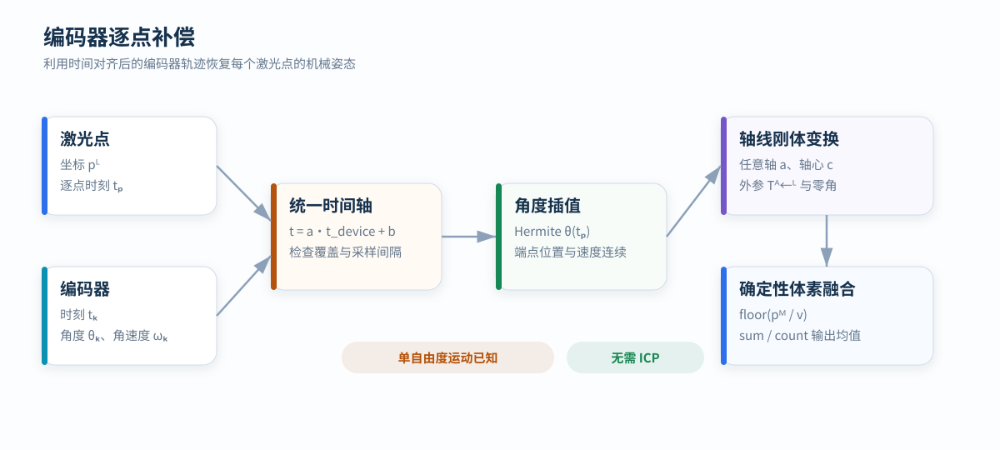

# 编码器逐点补偿建图

<p class="lead">固定轴扫描中，编码器给出机械角度，逐点时间决定每个回波对应的旋转姿态。算法将所有点变换到同一静止坐标系，再进行确定性体素融合。</p>

<div class="article-meta">
  <span>模型：单自由度固定轴运动</span>
  <span>输入：LiDAR + Encoder</span>
  <span>输出：统一坐标系体素地图</span>
</div>

<figure markdown="span">
  
  <figcaption>坐标和编码器观测先进入同一时间轴，随后完成角度插值、轴线变换和体素聚合。</figcaption>
</figure>

## 问题定义

激光雷达刚性安装在旋转机构上。机构绕固定轴转动，编码器离散输出角度和角速度。输入包括：

- 激光点坐标 `pᴸ` 与逐点测量时刻 `tₚ`；
- 编码器样本 `(tₖ, θₖ, ωₖ)`；
- 旋转轴方向 `a`、轴心参考点 `c` 与零角 `θ₀`；
- 雷达坐标系到轴坐标系的固定外参 `Tᴬ←ᴸ`；
- 轴坐标系到地图坐标系的固定变换 `Tᴹ←ᴬ`。

若旋转机构完全决定雷达运动，则无需通过 ICP 或 scan-to-map 估计轨迹。

## 时间轴

### 设备时间到主机时间

雷达、编码器控制器和主机可能使用不同的时钟。短时间内可用仿射模型表示设备时间到公共时间的映射：

<div class="equation">t_common = a · t_device + b

a：时钟速率比例，描述频率偏差
b：时钟偏移，描述两个时钟原点的差异</div>

参数 `a` 和 `b` 可以由多组时间对做稳健线性拟合。使用单个收包时间只能得到偏移的粗估，因为它混入了传输、排队和调度延迟。

### 点时间语义

一帧点云不是在同一时刻生成。每个点必须关联到发射或测量时刻。若数据只给出包时间，还需要根据包内点序、扫描周期和协议定义恢复相对时间。

飞行时间通常远小于机械扫描周期，但远距离目标的往返传播时间并非严格为零。时间戳究竟代表发射、接收还是内部测量基准，应以雷达协议为准，不能从主机收包时刻反推。

## 编码器角度插值

点时刻 `t` 落在两个编码器样本之间：

<div class="equation">(t₀, θ₀, ω₀), (t₁, θ₁, ω₁)
s = (t - t₀) / (t₁ - t₀)</div>

利用端点角度和角速度进行三次 Hermite 插值：

<div class="equation">h₀₀ = 2s³ - 3s² + 1
h₁₀ = s³ - 2s² + s
h₀₁ = -2s³ + 3s²
h₁₁ = s³ - s²

θ(t) = h₀₀θ₀ + h₁₀(t₁-t₀)ω₀
     + h₀₁θ₁ + h₁₁(t₁-t₀)ω₁</div>

Hermite 插值同时约束端点位置和速度，适合匀速或平滑变速段。它不能恢复采样间隔内未观测到的高频抖动，因此编码器间隔过大时应拒绝外推或插值。

角度跨越 `2π` 时必须先展开为连续角度。方向符号 `d∈{−1,+1}` 和零角给出实际旋转量：

<div class="equation">φ(t) = d · [θ(t) - θ_zero]</div>

## 绕任意轴的刚体变换

设 `a` 为单位轴向量，`c` 为轴上一点。点 `p` 绕轴旋转 `φ` 后为：

<div class="equation">p′ = c + R(a, φ) · (p - c)

R(a, φ) = I cosφ + (1-cosφ)aaᵀ + [a]× sinφ</div>

完整点变换写为：

<div class="equation">pᴹ = Tᴹ←ᴬ · AxisRotate(a, c, φ(t)) · Tᴬ←ᴸ · pᴸ</div>

转轴不必与地图竖直方向一致。轴向、轴心、安装偏心和雷达外参共同确定扫描面的空间位置。

## 体素融合

变换后的点按体素边长 `v` 建立整数键：

<div class="equation">k = floor(pᴹ / v)</div>

每个体素保存坐标、强度之和与计数：

```text
Σx, Σy, Σz, Σintensity, count
```

输出为体素内均值。只要累计次序不影响浮点精度，分块处理与一次性处理可以得到一致结果。体素边长控制输出密度和内存，不等于传感器测距精度。

## 误差如何进入地图

### 时间偏差

若点时间存在误差 `δt`，匀速段的一阶角度误差约为：

<div class="equation">δφ ≈ ω · δt</div>

目标到旋转轴的距离为 `r` 时，切向位置误差近似：

<div class="equation">δp ≈ r · δφ = r · ω · δt</div>

因此相同时间误差在高转速和远距离处产生更明显的错层。

### 轴线与外参误差

- 轴向误差会使远距离平面随角度产生扇形分层；
- 轴心误差表现为周期性平移残差；
- 零角误差造成整体方位偏差；
- 安装外参误差会在不同姿态间重复投影；
- 支架形变或轴摆破坏理想刚体假设。

该算法不递推上一帧位姿，因此不会产生典型里程计式随机游走；固定参数误差会在每圈重复出现。

## 可选惯性约束

当旋转机构存在可测的短时振动时，可在相邻编码器端点之间积分 IMU 角速度，并用编码器端点姿态约束区间轨迹。该模型增加了区间内姿态自由度，同时引入 IMU 零偏、外参和时间同步要求。

若机械运动严格符合单轴模型，纯编码器解更直接，也更容易解释误差来源。

## 计算复杂度与数据质量

逐点时间查询可通过单调游标完成，整体复杂度接近 `O(N + K)`，其中 `N` 为点数，`K` 为编码器样本数；体素哈希插入的平均复杂度为 `O(N)`。

有效输入应满足：

1. 编码器时间覆盖全部点时间；
2. 时间戳单调且角度完成展开；
3. 相邻编码器间隔不超过运动模型允许值；
4. 外参、轴线和角度单位一致；
5. 采集期间机构保持刚性，避免松动和弹性摆动。

## 方法边界

编码器逐点补偿属于运动模型驱动的去畸变与地图融合。它不执行通用场景回环、不估计自由六维轨迹，也无法仅凭输出地图区分时间偏差、轴线误差和结构形变。
