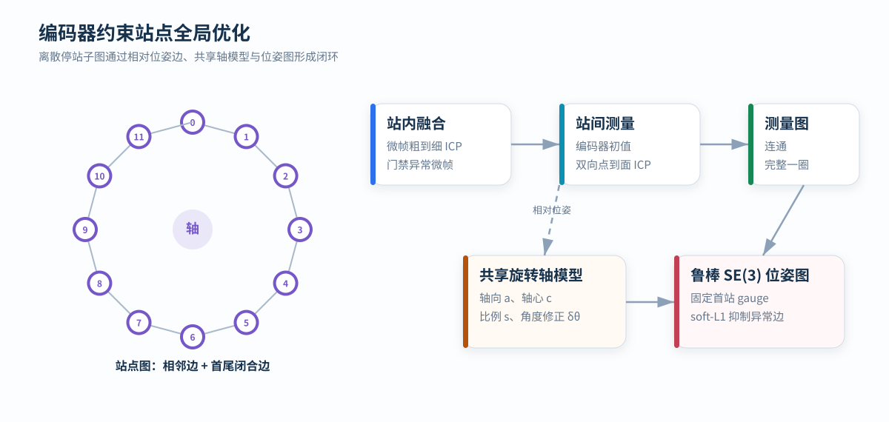

# 编码器约束站点全局优化

<p class="lead">旋转机构在离散角度停稳采集，每个站点形成静止子图。编码器提供运动初值，站间点云重合形成相对位姿测量，共享转轴模型与鲁棒位姿图联合恢复整圈一致地图。</p>

<div class="article-meta">
  <span>采集：Stop-and-scan</span>
  <span>观测：点到平面 ICP</span>
  <span>求解：共享轴 + SE(3) 位姿图</span>
</div>

<figure markdown="span">
  
  <figcaption>站点相对位姿边必须形成连通测量图；编码器轴模型作为结构先验参与联合约束。</figcaption>
</figure>

## 状态与观测

设一圈包含 `K` 个停站子图，第 `i` 站相对首站的位姿为 `Tᵢ∈SE(3)`。编码器给出相对角 `θᵢ`，点云注册给出站点对 `(i,j)` 的相对位姿测量 `Zᵢⱼ`。

待估变量可包含：

- 各站点位姿 `T₀ … Tₖ₋₁`；
- 共享旋转轴方向 `a`；
- 轴线上参考点 `c`；
- 编码器角度比例 `s`；
- 每站小角度修正 `δθᵢ`。

首站固定为参考坐标系，消除整组位姿的任意刚体自由度。

## 停站采集

典型站点过程为：

```text
转到目标角 → 速度降至阈值 → 确认稳定 → 采集静止窗口 → 转向下一站
```

站点数量不是理论常数。角度间隔越大，站点数量和采集时间越小，但相邻视场重叠也随之下降。能否稳定注册取决于雷达视场、场景深度、结构丰富度和初始角误差。

运动阶段的点不应混入静止站点，否则一个子图内部会同时包含多个姿态，后续刚体 ICP 无法完整解释这种形变。

## 站内微帧融合

一个站点的采集窗口可切分为多个短微帧。以首个微帧为参考，对其余微帧执行粗到细点到平面 ICP：

```text
粗体素扩大收敛范围 → 中等体素稳定法向 → 细体素精化局部位姿
```

微帧需通过以下门限后才能加入站点子图：

- 有效点和对应点数量；
- 平移、旋转增量范围；
- 点到平面残差；
- 法向分布与局部几何可观测性。

站内融合抑制轻微振动和偶发数据异常，但无法补偿持续运动或非刚体摆动。

## 编码器运动学初值

用粗略轴向 `a₀`、轴心 `c₀` 和编码器角度生成第 `i` 站初值：

<div class="equation">Tᵢ⁰ = AxisTransform(a₀, c₀, θᵢ)</div>

初值的作用是把站间 ICP 放入正确收敛盆地。编码器量化、零位、轴线和安装误差允许存在，但初始误差不能大到使对应结构落入错误位置。

## 站间点到平面 ICP

对具有足够重叠的站点对 `(i,j)`，求解相对变换：

<div class="equation">Eᵢⱼ(T) = Σₖ ρ[nₖᵀ(Tpₖ - qₖ)]</div>

其中 `pₖ` 为源点，`qₖ,nₖ` 为目标邻域拟合的平面点和法向，`ρ` 为 Huber 等鲁棒损失。

粗到细配准通常包含：

1. 体素降采样；
2. 目标点云法向估计；
3. 编码器相对位姿初始化；
4. 最近邻匹配和距离门限；
5. SE(3) 增量求解；
6. 收敛与几何质量检查。

## 双向一致性

分别计算 `Tᵢ→ⱼ` 和 `Tⱼ→ᵢ`。理想关系为：

<div class="equation">Tᵢ→ⱼ · Tⱼ→ᵢ ≈ I</div>

正反向平移和旋转闭合误差可用于发现局部极小值、弱重叠和方向相关的错误对应。双向一致并不保证配准一定正确，但能够排除一部分不稳定边。

## 共享旋转轴模型

机械运动先验可写为：

<div class="equation">Tᵢᵃˣⁱˢ = AxisTransform(a, c, s·θᵢ + δθᵢ)</div>

所有站点共享 `a,c,s`，只允许每站存在受限的角度修正 `δθᵢ`。与完全自由的站点位姿相比，共享轴减少参数自由度，使结果符合机构运动结构，并提高小数据条件下的稳定性。

轴线上参考点本身存在沿轴方向的规范自由度，通常选取距离坐标原点最近的点或固定一个轴向分量。

## SE(3) 位姿图

LiDAR 测量边和轴运动先验共同进入目标函数：

<div class="equation">min Σ(i,j) ρ( ‖Log[Zᵢⱼ⁻¹ · Tᵢ⁻¹ · Tⱼ]‖²_Ωᵢⱼ )
  + λ Σi ρ( ‖Log[(Tᵢᵃˣⁱˢ)⁻¹ · Tᵢ]‖²_Λ )</div>

第一项要求优化位姿与点云注册测量一致，第二项限制站点不要无依据偏离机械运动模型。信息矩阵 `Ωᵢⱼ` 和 `Λ` 控制不同约束的权重。

`soft-L1`、Huber 等鲁棒损失降低异常边的影响，但不能替代边验证。错误边过多或图拓扑错误时，鲁棒核仍可能收敛到错误全局解。

## 测量图条件

有效测量边至少应满足：

- 图连通，所有站点能通过 LiDAR 边连接到参考站；
- 覆盖完整旋转范围，首尾区域存在闭合约束；
- 每条边有足够对应点和法向方向；
- 注册结果没有明显偏离编码器初值；
- 优化后边残差和节点修正量处于允许范围。

编码器先验可以稳定图优化，但不应被伪装成 LiDAR 测量边来掩盖断开的配准图。

## 可观测性与退化

| 条件 | 影响 |
| --- | --- |
| 站点重叠不足 | ICP 无法建立可靠测量边 |
| 单一平面或高度对称场景 | 某些平移、旋转或轴参数约束弱 |
| 动态物体占比高 | 站间对应不满足静态刚体假设 |
| 编码器初值偏差过大 | ICP 落入错误收敛盆地 |
| 站点缺失 | 测量图断开或缺少首尾闭合 |
| 轴摆和结构形变 | 单一共享轴模型无法解释观测 |

## 地图生成与计算代价

优化完成后，每个站点点云按最终位姿投影：

<div class="equation">p_global = Tᵢ* · p_station,i</div>

所有站点在统一体素网格中合并。主要计算成本来自站内和站间 ICP；若候选边数接近全连接，配准次数为 `O(K²)`，因此通常根据角度邻近和视场重叠限制候选边。位姿图变量规模与站点数近似线性，远小于逐点优化。

这里的闭环来自已知的一圈站点拓扑，不包含未知长轨迹中的地点识别，因此不能替代通用 SLAM 回环检测。
