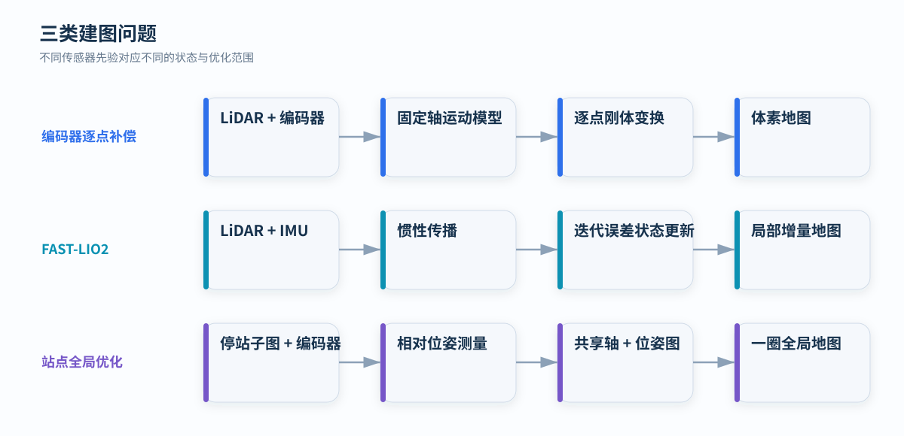

# 建图方法总览

<p class="lead">建图的核心不是简单叠加点云，而是确定每个点的观测时刻、传感器姿态和公共参考坐标系。运动先验不同，待估状态和优化范围也随之改变。</p>

<div class="article-meta">
  <span>主题：LiDAR Mapping</span>
  <span>核心：运动补偿 · 状态估计 · 全局一致性</span>
</div>

<figure markdown="span">
  
  <figcaption>三类方法分别把机械运动、惯性状态和站间点云约束作为主要信息源。</figcaption>
</figure>

## 统一坐标模型

设激光点在雷达坐标系中的坐标为 `pᴸ(t)`，雷达在地图坐标系中的位姿为 `Tᴹ←ᴸ(t)`。统一地图点为：

<div class="equation">pᴹ = Tᴹ←ᴸ(t) · pᴸ(t)</div>

三类方法的区别集中在 `Tᴹ←ᴸ(t)` 的获得方式：

- 编码器逐点补偿直接由机械运动模型计算位姿；
- FAST-LIO2 根据 IMU 传播与激光几何观测递推估计位姿；
- 站点全局优化先建立离散站点相对位姿，再进行批量一致性求解。

## 编码器逐点补偿

固定轴旋转机构只有一个主要运动自由度。编码器轨迹 `θ(t)`、旋转轴与安装外参确定雷达姿态，因此建图可分解为：

```text
逐点时间 → 查询编码器角度 → 绕轴刚体变换 → 体素融合
```

该方法不从点云反求运动。精度主要取决于时间对齐、轴线参数、编码器采样和结构刚度。

[编码器逐点补偿的完整模型](dual-encoder.md)

## FAST-LIO2

一般六自由度运动无法由单轴编码器描述。FAST-LIO2 使用 IMU 建立高频运动先验，并以激光点到局部地图平面的残差修正状态：

```text
IMU 传播 → 扫描去畸变 → 邻域平面拟合 → 迭代状态更新 → 增量地图
```

它同时估计姿态、位置、速度、IMU 零偏和重力方向，局部地图由 ikd-Tree 增量维护。

[FAST-LIO2 的状态与观测模型](kalman-fast-lio.md)

## 编码器约束站点优化

当电机在离散角度停稳采集时，每个站点形成一个静止子图。编码器给出站间旋转初值，点云重合提供相对位姿测量：

```text
站内融合 → 站间 ICP → 共享转轴拟合 → SE(3) 位姿图 → 全局融合
```

该方法在一圈数据范围内联合调整所有站点，能够抑制顺序拼接造成的累计闭合误差。

[站点全局优化的图模型](encoder-global-opt.md)

## 能力比较

| 维度 | 编码器逐点补偿 | FAST-LIO2 | 站点全局优化 |
| --- | --- | --- | --- |
| 主要传感器 | LiDAR、编码器 | LiDAR、IMU | LiDAR、编码器 |
| 运动模型 | 固定轴连续旋转 | 一般六自由度运动 | 离散停站 |
| 位姿来源 | 机械模型直接计算 | 惯性传播与激光观测估计 | 编码器初值与站间配准联合估计 |
| 点云配准 | 不需要 | scan-to-map | 站内与站间 ICP |
| 优化范围 | 单点独立变换 | 每帧递推状态 | 一圈站点批量优化 |
| 全局图优化 | 无 | 无 | 有，范围限于站点测量图 |
| 时间同步敏感性 | 高 | 高 | 中等，站内时间仍需一致 |
| 主要退化 | 时钟、轴线和外参错误 | 初始化失败、几何退化、IMU 饱和 | 重叠不足、错误边、测量图断开 |

## 评价指标

建图质量应从几何、覆盖与稳定性三个层面评价：

| 类别 | 指标 | 含义 |
| --- | --- | --- |
| 几何精度 | 平面 RMSE、点云厚度 | 同一实体表面被恢复为多厚的点带 |
| 尺度精度 | 控制点或控制边距离误差 | 地图中的相对距离与参考值之差 |
| 覆盖能力 | 占用体素数、区域覆盖率 | 空间中有多少位置获得有效观测 |
| 重复性 | 多次建图的同名面偏差 | 相同条件下输出是否稳定 |
| 一致性 | 闭合残差、站间相对残差 | 局部约束在全局坐标中是否相容 |
| 计算代价 | 延迟、峰值内存、每秒处理点数 | 算法能否满足输出周期和资源限制 |

单一指标不能完整代表建图质量。例如，减小体素可增加输出点数，却不会修复错误的时间同步或重复表面分层。
