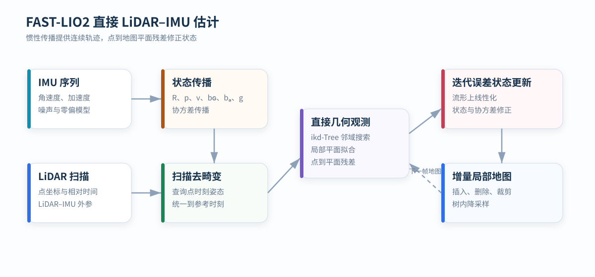

# FAST-LIO2：直接 LiDAR–IMU 里程计

FAST-LIO2 将高频惯性传播与原始激光点的局部平面观测结合，在流形上迭代更新运动状态，并使用 ikd-Tree 维护可增量修改的局部地图。

  基线：FAST-LIO2
  估计：6DoF 状态与 IMU 零偏
  地图：增量 ikd-Tree

公开来源：<a href="https://github.com/hku-mars/FAST_LIO">hku-mars/FAST_LIO</a>，固定代码版本 <code>a4743b095409588842a5b30ddfa27e29d2f99164</code>。理论参考 FAST-LIO2、IKFoM 与 ikd-Tree。

<figure markdown="span">
  
  <figcaption>IMU 负责高频预测，激光点到局部地图平面的残差负责观测修正。</figcaption>
</figure>

## 状态空间

典型状态写为：

x = {R, p, v, bɢ, bₐ, g, Rᴵ←ᴸ, tᴵ←ᴸ}

其中：

- `R, p, v`：IMU 在世界坐标系中的姿态、位置和速度；
- `bɢ, bₐ`：陀螺仪与加速度计零偏；
- `g`：重力向量；
- `Rᴵ←ᴸ, tᴵ←ᴸ`：LiDAR 到 IMU 的外参，可固定或参与估计。

姿态属于旋转群 `SO(3)`，状态更新不能直接使用普通向量加法。IKFoM 在流形切空间中表示小误差，再通过指数映射把增量作用到姿态。

## 静止初始化

启动阶段利用静止 IMU 样本估计：

- 平均角速度，用于陀螺零偏初值；
- 平均加速度方向，用于重力方向；
- 加速度与角速度方差，用于判断是否满足静止假设。

设备运动时，重力、线加速度和零偏无法从短时间均值中分离。错误初始化会直接污染后续传播，因此静止性是可观测条件，不是简单的流程检查。

## 惯性传播

忽略离散化细节，连续时间模型为：

Ṙ = R · Exp(ωₘ - bɢ - nɢ)
ṗ = v
v̇ = R(aₘ - bₐ - nₐ) + g
ḃɢ = n_bɢ
ḃₐ = n_bₐ

IMU 到达时，滤波器积分名义状态，同时传播误差状态协方差。传播轨迹提供扫描内部任意点时刻的姿态和位置。

## 扫描去畸变

旋转式或非重复扫描 LiDAR 的一帧点云跨越有限时间。设点的测量时刻为 `tₚ`，参考时刻为 `tᵣ`，去畸变关系为：

pᴸ(tᵣ) = (Tᵂ←ᴸ(tᵣ))⁻¹ · Tᵂ←ᴸ(tₚ) · pᴸ(tₚ)

`Tᵂ←ᴸ(t)` 由 IMU 传播轨迹和 LiDAR–IMU 外参得到。缺少逐点时间或时间同步不准时，运动中的平面会弯曲、拉伸或出现多层。

## 直接点到平面观测

FAST-LIO2 不依赖边缘点、平面点等人工特征类别。对每个去畸变点，在局部地图中搜索邻域并拟合平面：

nᵀx + d = 0

点变换到世界坐标后，观测残差为：

r = nᵀ(Rpᴸ + t) + d

残差对误差状态线性化得到观测雅可比。邻域点不满足平面性、距离过大或残差异常时，该观测应被拒绝。

## 迭代误差状态更新

一次线性化只在当前状态附近成立。FAST-LIO2 对同一帧重复执行：

1. 按当前状态把点投影到地图；
2. 重新搜索邻域并拟合局部平面；
3. 构造残差与雅可比；
4. 在流形切空间求解状态增量；
5. 更新名义状态，直到增量收敛或达到迭代上限。

这种迭代形式比单次 EKF 更新更能处理较强非线性，同时仍保留惯性先验协方差的约束。

## ikd-Tree 局部地图

状态收敛后，当前点云插入 ikd-Tree。该数据结构支持：

- 动态插入和删除；
- k 近邻搜索；
- 局部地图范围裁剪；
- 树内体素式降采样；
- 不平衡子树的异步或增量重建。

局部地图只保留传感器附近的有效区域，避免地图规模随轨迹无限增长。地图点过密会增加邻域搜索代价，过稀则降低平面拟合稳定性。

## 几何可观测性

点到平面残差只能约束平面法向方向。若局部环境只有单一无限平面，则沿平面内的平移和绕法向旋转约束很弱。长直走廊、重复结构与远距离稀疏点也会形成不同程度的退化。

可通过观测雅可比的特征值、有效平面点分布和状态协方差变化识别退化。IMU 能在短时间内提供运动先验，但不能凭空补足长期缺失的几何约束。

## 参数作用

| 参数类别 | 主要影响 |
| --- | --- |
| IMU 噪声与随机游走 | 传播协方差、滤波器对惯性先验的信任程度 |
| LiDAR–IMU 时间偏移 | 扫描去畸变和观测投影的一致性 |
| 外参 | 所有点的姿态与杠杆臂补偿 |
| 邻域数量与平面阈值 | 观测数量、平面稳定性和误匹配率 |
| 地图体素 | 搜索规模、局部细节和内存占用 |
| 迭代终止阈值 | 每帧计算量与非线性收敛程度 |
| 局部地图范围 | 长期结构保留与实时搜索代价 |

## 计算结构

设一帧保留 `N` 个点，局部树包含 `M` 个点。近邻搜索近似为 `O(N log M)`，实际耗时还取决于迭代次数、平面拟合和 ikd-Tree 更新。IMU 传播与 IMU 样本数线性相关。

FAST-LIO2 是里程计和局部增量建图方法。它不包含地点识别、通用回环检测和全局位姿图；长时间全局一致性需要额外的回环与图优化模块。

## 参考资料

- [FAST-LIO2: Fast Direct LiDAR-inertial Odometry](https://arxiv.org/abs/2107.06829)
- [FAST_LIO](https://github.com/hku-mars/FAST_LIO)
- [ikd-Tree](https://github.com/hku-mars/ikd-Tree)
- [IKFoM: Kalman Filters on Differentiable Manifolds](https://arxiv.org/abs/2102.03804)
