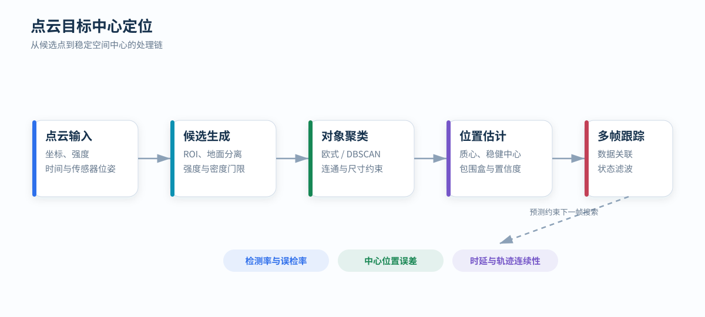

# 点云目标中心定位

目标中心定位把一组稀疏、含噪且可能遮挡的回波转换为稳定空间位置。可靠流程需要把候选生成、聚类、中心估计和多帧关联分别评价。

  任务：目标检出与中心坐标
  特征：几何 · 强度 · 时间连续性

<figure markdown="span">
  
  <figcaption>多帧预测限制下一帧搜索区域，同时降低稀疏回波造成的中心跳动。</figcaption>
</figure>

## 候选点生成

候选点通常由多个条件共同筛选：

- 空间 ROI：限制距离、高度和方位范围；
- 地面分离：使用平面、渐进形态学或栅格高度模型；
- 强度门限：筛选具有特定反射特性的材料；
- 局部密度：排除孤立噪点；
- 运动区域：利用帧间差异缩小搜索范围。

强度受距离、入射角、目标材料、接收增益和设备标定影响。固定强度阈值应在不同距离和姿态下验证，不能把显示颜色直接等同于物理反射率。

## 三维聚类

### 欧式聚类

以距离阈值连接相邻点，并提取连通分量。计算简单，但固定距离阈值对近密远疏的激光点云不够稳健。

### DBSCAN

DBSCAN 使用邻域半径 `ε` 和最小点数 `minPts` 定义密度连通。它能把稀疏离群点标记为噪声，但同样需要处理距离相关的点密度变化。

一种常用策略是分距离带设置阈值，或在角度空间与笛卡尔空间共同约束邻接关系。

## 几何门限

聚类后可根据以下特征剔除不合理对象：

- 点数和占用体素数；
- 高度、宽度和深度；
- 主成分方向与特征值比例；
- 垂直分布和离地高度；
- 强度均值、分位数及高强点比例。

几何门限应基于真实观测分布，而不是仅根据物理尺寸设置。遮挡会使观测尺寸小于目标真实尺寸，远距离稀疏采样会使点数大幅下降。

## 中心位置估计

不同中心定义具有不同物理意义：

| 方法 | 特性 |
| --- | --- |
| 全部点质心 | 简单，但受遮挡和离群点影响 |
| 坐标中位数 | 对离群点稳健，不利用形状模型 |
| 截尾均值 | 去除极端分位后求均值，稳定性较好 |
| 包围盒中心 | 依赖边界完整性，遮挡侧会产生偏移 |
| 模型拟合中心 | 可补偿部分缺失，需要可靠目标模型 |
| 强度加权中心 | 强调高反射区域，代表的是标记中心而非几何中心 |

若目标带有高反射标记且任务只需要定位标记，可以对高强度点聚类后使用稳健质心；若需要目标几何中心，则必须建立标记位置到目标中心的固定偏移模型。

## 多帧关联

设轨迹状态为位置和速度：

x = [pₓ, pᵧ, p_z, vₓ, vᵧ, v_z]ᵀ

常速度模型给出下一帧预测，检测结果通过马氏距离、欧氏距离或三维 IoU 与轨迹关联。卡尔曼滤波负责平滑中心位置并估计不确定性。

关联门限过小会造成轨迹频繁中断，过大则会在多目标靠近时交换身份。即使不需要识别具体身份，短时轨迹仍能抑制中心跳动和偶发漏检。

## 传感器旋转时的坐标处理

雷达安装在旋转机构上时，检测点首先处于瞬时雷达坐标系。中心位置必须通过该时刻的机构姿态变换到固定坐标系：

p_fixed = T_fixed←lidar(t) · p_lidar

若在每个离散方位独立检测，可维护各扇区的局部背景和 ROI，再把结果统一到固定坐标系关联。重复扫描同一区域时，不能直接在未补偿角度的雷达坐标中叠加轨迹。

## 评价指标

| 指标 | 含义 |
| --- | --- |
| Precision / Recall | 误检与漏检的平衡 |
| 中心位置 MAE / RMSE | 检出目标的定位误差 |
| P95 定位误差 | 长尾误差水平 |
| 轨迹连续率 | 有效目标保持连续输出的比例 |
| 中心抖动 | 静止目标位置的标准差或 Allan 类统计 |
| 首次检出时延 | 目标进入可观测区域到稳定输出的时间 |
| 端到端时延 | 点产生到中心位置发布的总延迟 |

指标应按距离、遮挡程度、入射角和目标点数分层统计。总体均值可能掩盖远距离或低点数条件下的明显退化。
