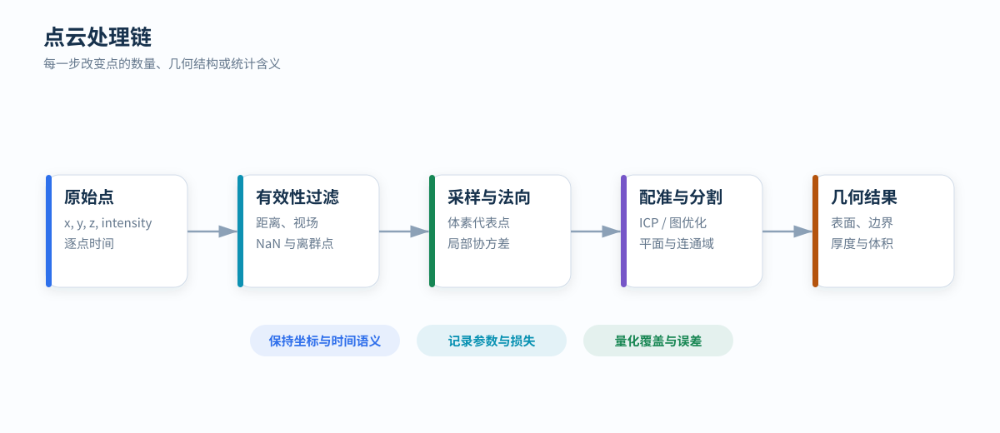

# 点云处理

点云处理改变点的数量、空间分布或统计含义。每一步都应明确输入坐标系、时间语义、参数尺度和质量评价，避免用点数变化代替几何质量判断。

  流程：过滤 · 采样 · 配准 · 分割 · 几何
  输入：XYZ + 时间 + 强度

<figure markdown="span">
  
  <figcaption>点云从原始观测到几何结果，每一级都应保留可追溯的参数和统计。</figcaption>
</figure>

## 数据语义

一个点至少包含坐标 `(x,y,z)`，常见附加字段包括强度、环号、逐点时间、回波序号和传感器标识。处理前需要确定：

- 坐标属于雷达、载体还是地图坐标系；
- 距离单位和角度单位；
- 时间戳代表帧、包还是单点；
- 强度是原始能量、归一化反射率还是设备映射值；
- 多回波点的保留策略。

字段含义不一致时，即使文件可以正常读取，后续过滤和配准也可能产生系统性错误。

## 有效性过滤

基础过滤通常包含：

1. 删除 NaN、Inf 和零距离点；
2. 按最小、最大距离裁剪；
3. 按水平和垂直视场裁剪；
4. 根据设备状态或包完整性排除无效帧；
5. 对孤立点、飞点和多径点进行统计过滤。

统计离群点滤波利用邻域距离分布，半径滤波检查给定半径内的邻居数量。两者都可能误删远距离稀疏目标，因此参数应随角分辨率和距离变化评估。

## 体素降采样

体素键为：

k = floor(p / v)

一个体素可以选择中心、首点、随机点或所有点的质心作为代表。质心能降低采样噪声，但会生成一个原始观测中不存在的位置；首点保留真实回波，却与输入顺序相关。

体素边长 `v` 决定空间离散尺度。若目标细节尺寸接近 `v`，结构可能被抹平。输出点数随 `v` 变化不能直接解释为传感器覆盖变化，因此跨参数比较时应在统一评价体素上统计占用率。

## 法向与局部平面

对点 `p` 的邻域计算协方差：

C = (1/N) Σᵢ (pᵢ-p̄)(pᵢ-p̄)ᵀ

最小特征值对应的特征向量可作为平面法向。三个特征值的比例反映局部结构：

- 一个特征值远小于另外两个：近似平面；
- 两个特征值较小：近似线结构；
- 三个特征值接近：散乱或体状分布。

邻域过小会受噪声影响，过大会跨越边缘。固定半径与固定邻居数适合不同密度条件。

## 点到平面 ICP

给定源点 `pᵢ`、目标对应点 `qᵢ` 和法向 `nᵢ`，目标函数为：

minT Σᵢ ρ[nᵢᵀ(Tpᵢ-qᵢ)]

点到平面 ICP 在局部平滑表面上通常比点到点 ICP 收敛更快。稳定配准依赖：

- 合理初始位姿；
- 足够视场重叠；
- 多方向几何结构；
- 对应距离和法向夹角门限；
- 鲁棒核与异常对应剔除。

ICP 收敛只说明到达局部最小值，不代表找到正确配准。应同时检查重叠区域、变换增量、正反向一致性和几何可观测性。

## 分割与表面重建

常见分割方法包括：

- RANSAC 平面、圆柱和球模型；
- 欧式连通聚类与 DBSCAN；
- 基于法向、曲率和区域生长的表面分割；
- 地面模型与高度栅格；
- 基于网格或体素的连通域分析。

表面重建可使用三角网格、高度场、TSDF 或占用体素。方法选择取决于对象是否满足单值高度、是否存在遮挡和是否需要封闭体积。

## 几何质量指标

| 指标 | 计算对象 | 说明 |
| --- | --- | --- |
| 点到平面 RMSE | 拟合平面或参考面 | 表面噪声与配准残差 |
| 厚度 P95 | 点到中位平面绝对距离 | 对少量离群点更稳健 |
| 占用体素数 | 固定评价体素 | 空间覆盖的绝对规模 |
| 相对覆盖率 | 参考数据占用体素集合 | 当前数据覆盖参考空间的比例 |
| Chamfer 距离 | 两组点云 | 双向最近邻差异 |
| 完整率 / 准确率 | 参考表面 | 缺失区域与错误表面的平衡 |

所有距离型指标都应注明评价范围、体素尺度、最近邻上限和是否经过配准。
